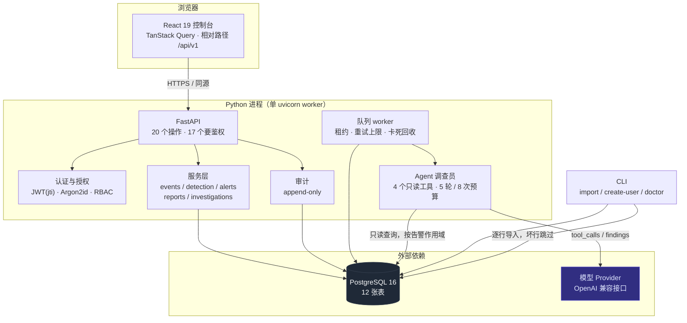
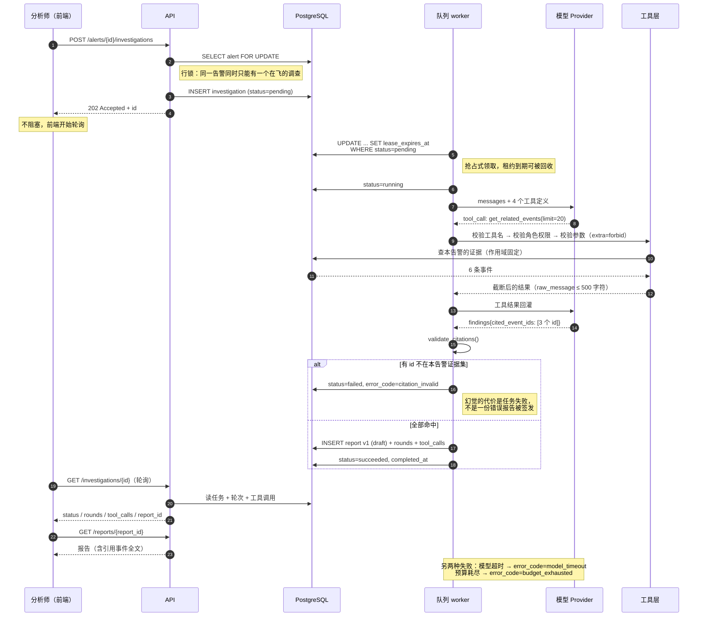
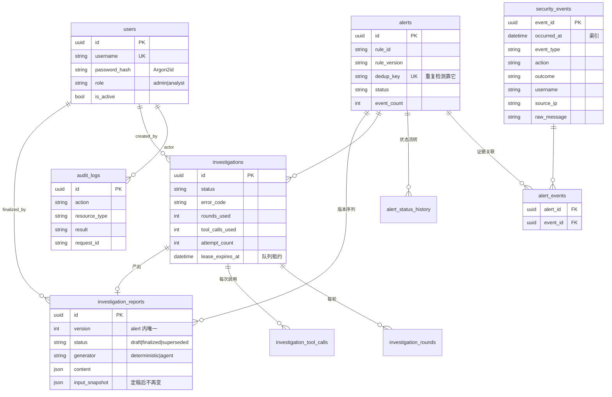
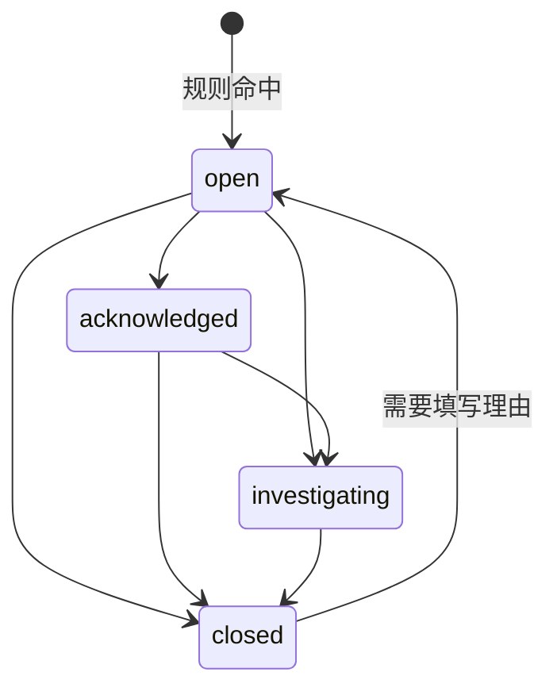
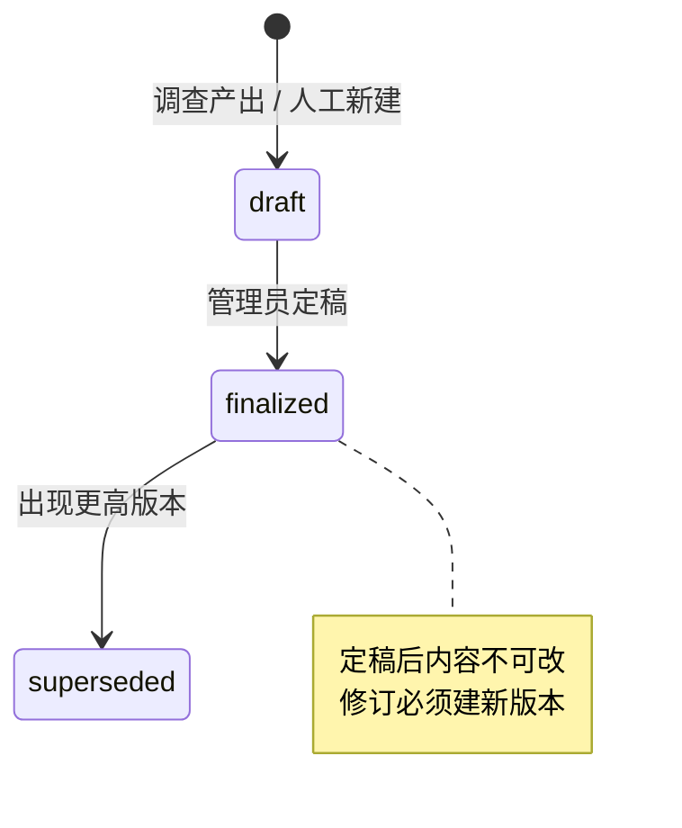

# 架构图

四张图：系统怎么组装、一次调查怎么走、数据怎么连、状态怎么流转。

图用 Mermaid 写，GitHub 直接渲染；本机可用 `npx @mermaid-js/mermaid-cli` 导出 PNG。

---

## 1. 系统组成



三个刻意的边界：

- **API 进程和 worker 在同一个进程里，但不共享内存状态。** 队列是 `investigations` 表，
  租约是 `lease_expires_at` 列。进程崩了，租约到期后任务被别的 worker 领走——
  这就是为什么不需要 Redis 或 Celery。
- **Agent 不直接连数据库。** 它只拿到 `ToolContext`（session + 本告警 + 证据 id 集合），
  所有查询都经过工具层，而工具层只暴露 4 个函数。
- **前端只调相对路径。** 部署时不需要 CORS，也不需要把 API 地址编进构建产物。

---

## 2. 一次调查的时序

这是整个项目最值得看的一张图：标出了三个会**主动失败**的位置。



失败路径不是补上去的，是设计的一部分：

| 情况 | 结果 | 代码位置 |
| --- | --- | --- |
| 模型超时 | `error_code=model_timeout`，任务终止 | `ai/agent.py` 的模型调用异常分支 |
| 引用不存在的 id | `error_code=citation_invalid`，整次失败 | `validate_citations()` |
| 轮次/调用/运行时长耗尽 | `error_code=budget_exhausted` | 三个预算检查 |
| 工具超时 | 该次调用记为失败，模型可以换策略 | 线程池 + 5 秒超时 |
| worker 崩溃 | 租约到期后重新领取，超过 `max_attempts` 判 failed | `services/investigation_worker.py` |
| 工具名不在白名单 | 模型调用前就拒绝，不进入执行 | `TOOL_SPECS` 查找 |

---

## 3. 数据模型（12 张表）



三个约束值得单独说：

- `alerts.dedup_key` 唯一。**重复运行检测的幂等性不是靠应用层判断，是靠数据库拒绝。**
- `investigation_reports (alert_id, version)` 唯一。并发建版本时后者会撞约束，
  而不是悄悄产生两个 v2。
- `audit_logs` 没有任何 UPDATE/DELETE 路径，也没有对应的 API。

---

## 4. 两个状态机

告警状态（`services/alerts.py`）：



报告版本（`services/investigation_reports.py`）：



`closed → open` 是唯一要求写理由的转换（`REASON_REQUIRED_TRANSITIONS`）。
理由不是自由文本摆设：它进 `alert_status_history`，也进审计。

---

## 5. 部署形态

没有容器。三个进程，一条命令各自启动：

```text
终端 1   PostgreSQL 16                     127.0.0.1:5432
终端 2   uvicorn sentinelflow.main:app     127.0.0.1:8000
终端 3   npm run dev                       127.0.0.1:5173
```

生产形态把终端 3 换成 `npm run build` 的静态产物，由任意反向代理托管，
`/api` 反代到 8000。**没有 TLS、没有多副本、没有反向代理配置**——
这三件事在 `docs/V1_ACCEPTANCE.md` §7 里列为"未验证"，
不是漏了，是刻意不写没跑过的东西（见 `docs/DECISIONS.md` D-050）。
